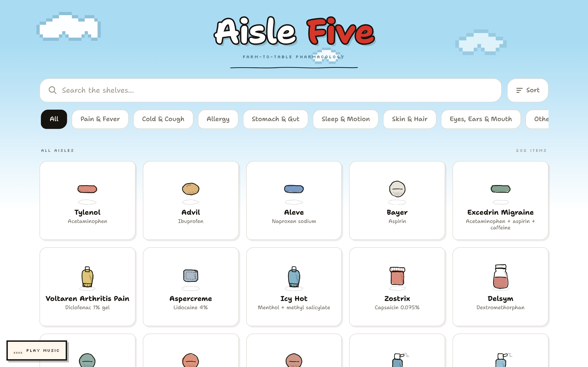
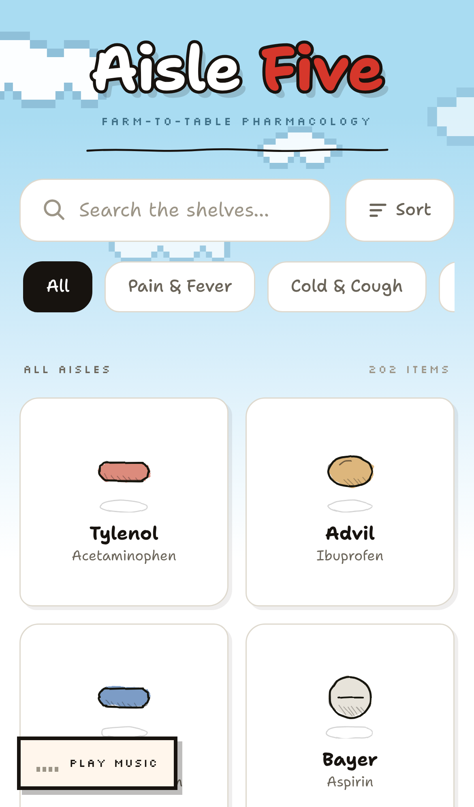
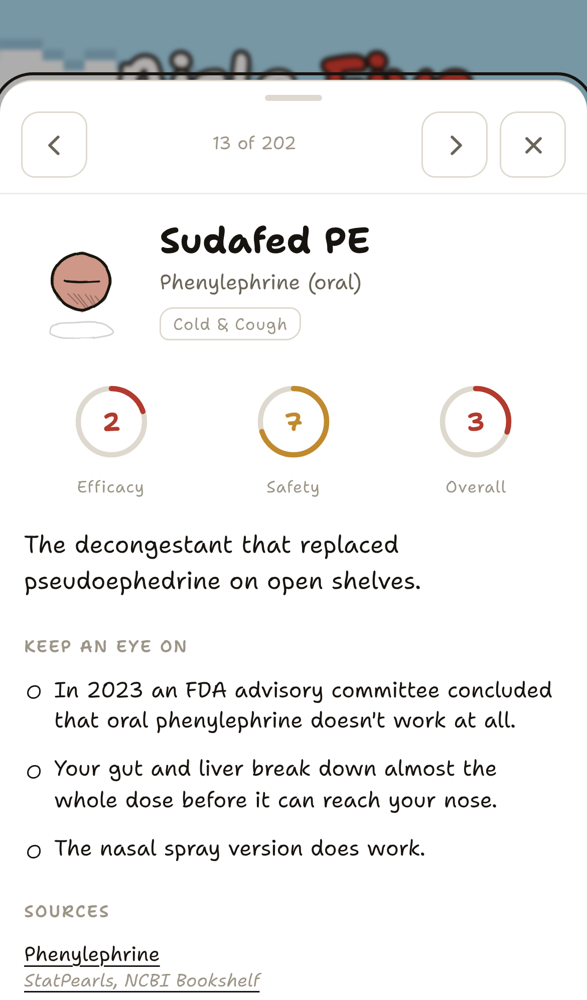

# Aisle Five

Aisle Five is a website where you can look up common over-the-counter medicines and see how well they work and how safe they are. It's live at **[aislefive.netlify.app](https://aislefive.netlify.app)**.

  
  

Right now there are 202 medicines on it, all things you'd find at a regular drugstore. Pain relievers, cold medicine, allergy pills, antacids, sleep aids, creams, eye drops and a lot more. Each one has three scores out of 10, a short note on what it's for, a few things to watch out for, where you can buy it, and two sources you can click through to.

They're split into eight categories. Those are Pain & Fever, Cold & Cough, Allergy, Stomach & Gut, Sleep & Motion, Skin & Hair, Other, and Eyes, Ears & Mouth.

## The scores

Efficacy is how well the medicine does what it's sold for, based on the clinical evidence. Safety is how risky it is to take.

The overall score is a judgment call based on both, so it doesn't always land in the middle. Sudafed PE is a good example. It's fairly safe (7), but the pill version barely works (2), so it only gets a 3 overall. Benadryl does work for allergies (6), but its safety score is a 1, so it ends up with a 2.

The score rings are green for 8 to 10, yellow for 6 or 7, and red for 5 and under. At the moment Narcan, Tums and Pedialyte are the only ones with a 10 overall.

## Sources

Every entry links to two sources. One is the StatPearls chapter for that drug on the NCBI Bookshelf. The other is a study on PubMed. That comes out to 404 links across the whole site.

This isn't medical advice. The scores are my read of the published evidence, and what's sold where can change from country to country and over time. Check the label, and ask a pharmacist if you're not sure.

## Using the site

You can search by brand name or generic name, filter by category, and sort by any of the three scores, high to low or low to high. Tap a card to open the full entry. From there you can go to the next or previous medicine with the arrows (or the arrow keys on a computer). Every entry has its own link, like [aislefive.netlify.app/#advil](https://aislefive.netlify.app/#advil), so you can send someone straight to one medicine.

There's background music so it feels like you're in a store. You can turn it off with the button in the corner. Tapping cards also makes small sound effects. None of the medicine drawings are image files. They're drawn in code, and each one is randomized off the medicine's ID, so no two look exactly alike but the same medicine always comes out the same. The storefront and clouds are pixel art that's also drawn in code.

## What's in here

`index.html` is the entire site. There's no build step and nothing to install. It's a little over 2 MB because the music file is stored inside it.

`data/medicines.csv` is every entry in one table, with the scores, notes and source links. GitHub shows it as a table you can search. It's copied from the list inside `index.html`, so if the two ever don't match, go with `index.html`.

`screenshots/` has the pictures at the top of this page.

## Running it yourself

Download `index.html` and open it in a browser. You'll need internet for the fonts and the source links, but everything else is in the file. To host your own copy, upload that one file to any static host like Netlify or GitHub Pages.

## AI disclosure

I used Claude, made by Anthropic, to code this site. I came up with the idea and the name, made the design choices, decided what features it would have, gave every medicine its efficacy, safety and overall scores, and did the pharmacology and neuroscience work behind those scores. Claude was the tool that turned all of that into a working website. I also used it to help find and double-check the sources and to clean up the wording of the entries.
